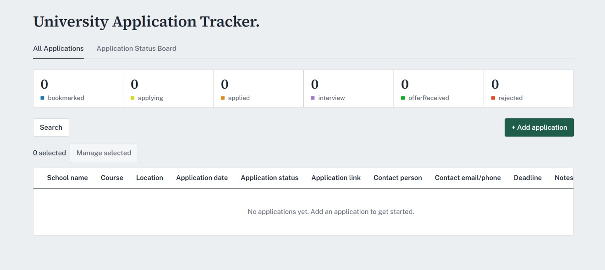
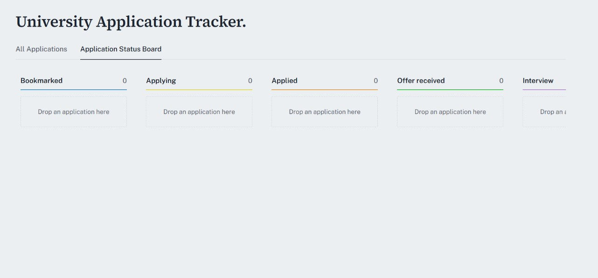

Track university applications, deadlines and status in a table or Kanban board

Features, e.g. sortable table, drag-and-drop status board, bulk status updates, data saved locally in the browser.
Tech stack: React, Vite, dnd-kit, Radix UI.